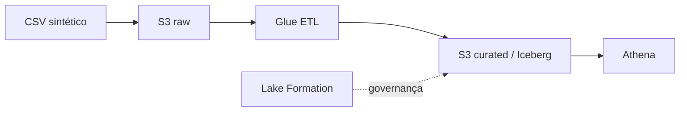

# AWS Data Lakehouse | Pipeline de dados

Projeto demonstrativo de ingestão, transformação e consulta de dados com arquitetura inspirada em serviços AWS.

**Serviços previstos:** Amazon S3, AWS Glue, Amazon Athena, Apache Iceberg e AWS Lake Formation. EventBridge, Lambda e Step Functions podem ser integrados posteriormente.

## Arquitetura proposta



## Executar localmente

```bash
python src/generate_data.py
python src/transform.py
```

Os scripts usam apenas a biblioteca padrão do Python. Os resultados são gravados em `data/`.

## Arquivos

- `src/generate_data.py`: gera pedidos fictícios.
- `src/transform.py`: valida pedidos e agrega faturamento por produto.
- `data/orders.csv`: pedidos sintéticos.
- `data/sales_by_product.csv`: resumo de vendas.
- `sql/athena.sql`: consulta de exemplo.

## Próximas etapas na AWS

1. Criar áreas `raw/` e `curated/` no S3.
2. Catalogar os dados com Glue.
3. Implementar uma tabela Iceberg.
4. Consultar os dados no Athena.
5. Definir políticas no Lake Formation.

**Escopo:** demonstração local. A arquitetura AWS é proposta, não implantada. Não há credenciais ou materiais internos de exames.
